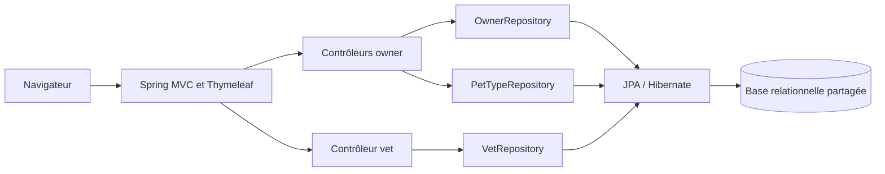
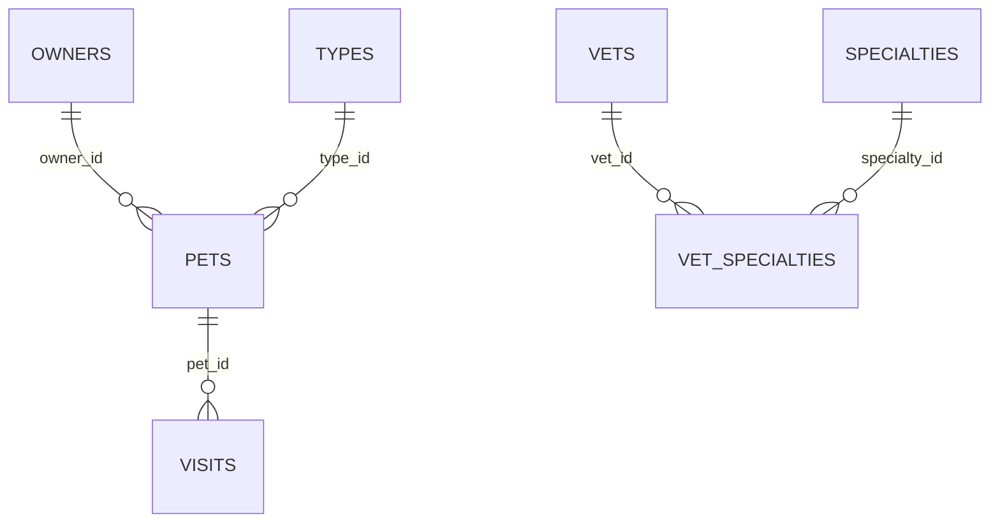

# Architecture actuelle de Spring Petclinic

## Périmètre

Cette page décrit le code présent dans le dépôt et les frontières de données observées. Le backend est un monolithe Spring Boot : les domaines ne sont pas encore des microservices autonomes. Les manifests Kubernetes décrivent une cible de déploiement et ne prouvent pas, à eux seuls, que les composants sont installés dans le cluster.

## Vue d'ensemble

L'application est démarrée par `PetClinicApplication`. Spring MVC sert les pages Thymeleaf et un endpoint JSON pour les vétérinaires. Les repositories Spring Data accèdent à une base relationnelle unique. Les profils configurent H2 par défaut, ainsi que PostgreSQL et MySQL; le manifeste Kubernetes de Petclinic active PostgreSQL.

## Organisation du code

| Zone | Rôle et principaux composants |
|---|---|
| `PetClinicApplication` | Point d'entrée Spring Boot. |
| `model` | Classes JPA communes : `BaseEntity`, `NamedEntity`, `Person`. |
| `owner` | `Owner`, `Pet`, `PetType`, `Visit`, leurs contrôleurs, repositories et validations. Les données sont fortement liées dans les parcours d'écriture. |
| `vet` | `Vet`, `Specialty`, `VetController`, `VetRepository`; liste paginée HTML et liste JSON. Le repository met les lectures en cache. |
| `system` | Page d'accueil, configuration Web/cache et contrôleur de crash de démonstration. |
| `resources/db` | Schémas et données d'initialisation H2, MySQL et PostgreSQL. |

## Parcours HTTP et dépendances

| Parcours | Traitement et données touchées |
|---|---|
| `GET /` | `WelcomeController` renvoie la vue d'accueil. |
| `GET /owners`, `GET /owners/{ownerId}` | `OwnerController` recherche et lit les propriétaires via `OwnerRepository`; l'affichage du propriétaire charge aussi ses animaux. |
| `POST /owners/new`, `POST /owners/{ownerId}/edit` | Crée ou modifie un propriétaire via `OwnerRepository`. |
| `/owners/{ownerId}/pets/...` | `PetController` charge le propriétaire et les types via `OwnerRepository` et `PetTypeRepository`; l'ajout ou la modification d'un animal sauvegarde l'agrégat `Owner`. |
| `/owners/{ownerId}/pets/{petId}/visits/new` | `VisitController` charge Owner puis Pet, ajoute Visit au Pet et sauvegarde Owner via `OwnerRepository`. |
| `GET /vets.html` | `VetController` renvoie une liste HTML paginée depuis `VetRepository`. |
| `GET /vets` | Renvoie l'objet JSON `Vets` avec la liste fournie par `VetRepository`. |

Il n'existe pas de couche de service métier séparée entre ces contrôleurs et repositories pour les parcours décrits ci-dessus. En particulier, les parcours Pet et Visit utilisent directement le repository du propriétaire.

## Modèle relationnel PostgreSQL

Le schéma de référence est `src/main/resources/db/postgres/schema.sql`.

| Table | Colonnes | Contraintes et rôle |
|---|---|---|
| `owners` | `id`, `first_name`, `last_name`, `address`, `city`, `telephone` | Propriétaire; index sur `last_name`. |
| `types` | `id`, `name` | Référentiel des types d'animaux. |
| `pets` | `id`, `name`, `birth_date`, `type_id`, `owner_id` | `type_id` référence `types.id` et est NOT NULL; `owner_id` référence `owners.id`. Index sur `name` et `owner_id`; unicité du nom d'animal par propriétaire. |
| `visits` | `id`, `pet_id`, `visit_date`, `description` | `pet_id` référence `pets.id`; index sur `pet_id`. |
| `vets` | `id`, `first_name`, `last_name` | Vétérinaire; index sur `last_name`. |
| `specialties` | `id`, `name` | Référentiel des spécialités; index sur `name`. |
| `vet_specialties` | `vet_id`, `specialty_id` | Table d'association; références `vets.id` et `specialties.id`, paire unique. |

Les clés primaires sont des identifiants générés par la base. Dans le code JPA, `Owner` possède une collection `pets` avec cascade; `Pet` référence `PetType` et possède une collection `visits` avec cascade. `Vet` référence plusieurs `Specialty` au moyen de `vet_specialties`. Les références SQL entre ces tables ne deviennent pas des clés étrangères inter-bases après une extraction.

## Frontières candidates pour la migration

### Vet

Le groupe de données est limité à `vets`, `specialties` et `vet_specialties`, sans clé étrangère vers Owner/Pet/Visit. Les endpoints présents sont en lecture seule et `VetRepository` met ses résultats en cache. C'est une frontière candidate pour un premier pilote de lecture, mais il faut décider qui gérera les futures modifications de vétérinaires et spécialités : aucun parcours HTTP d'écriture n'apparaît dans `VetController`.

### Owner, Pet et Visit

Ces données sont fortement couplées :

- `OwnerController` lit et sauvegarde Owner;
- `PetController` ajoute ou modifie Pet au travers de Owner;
- `VisitController` retrouve Visit en chargeant Owner puis Pet et sauvegarde Owner;
- les relations Owner-Pet et Pet-Visit ont des cascades JPA.

Les séparer en trois services sans redessiner ces opérations créerait des appels réseau et des problèmes de cohérence à la place des relations transactionnelles actuelles. `types` doit aussi rester disponible à Pet comme référentiel ou contrat explicite.

## Conséquences pour la migration des données

1. Choisir un seul domaine et établir la propriété des tables avant de créer sa base.
2. Pour Vet, transférer ensemble les trois tables en conservant les identifiants et l'association `vet_specialties`; valider les comptes et références après copie.
3. Comme les endpoints Vet existants sont en lecture seule, une copie contrôlée peut suffire si aucune écriture concurrente n'est requise. CDC n'est justifié que si la source doit continuer à changer pendant le transfert et que la cible doit rester synchronisée.
4. Pour Owner/Pet/Visit, décider d'abord si le premier service possède tout l'agrégat ou si les frontières et APIs sont redessinées. Ne pas déplacer une table isolément sur la seule base de son nom.
5. Après bascule, nommer un propriétaire unique des écritures. Un retour au monolithe doit tenir compte des écritures éventuellement faites dans la nouvelle base.

## Infrastructure Kubernetes présente dans les manifests

Le dossier `k8s/` contient les namespaces `gateway`, `microservices`, `monitoring` et `logging`; Petclinic et PostgreSQL restent dans le namespace standard `default`. Il contient les manifests de Petclinic/PostgreSQL, le gateway, EFK (`logging.yml`) et Prometheus/Grafana/Alertmanager (`monitoring-stack.yml`). Ces fichiers sont la configuration déclarative; leur présence ne signifie pas que les ressources sont appliquées ou opérationnelles.

Le manifest de Petclinic référence le Service PostgreSQL `demo-db` dans `default`, comme la base source existante. Le gateway, dans `gateway`, et l'Ingress définissent le chemin d'entrée vers Petclinic dans `default`. Le namespace `microservices` est une cible réservée; les frontières métier et les services extraits doivent encore être définis.

## Prochaine étape de cartographie

Avant une extraction, documenter pour le domaine choisi : contrôleur et routes, classes JPA, repositories, tables lues/écrites, validations, vues dépendantes, comportement lors d'une panne, propriétaire après bascule, stratégie de copie/CDC et scénario de retour arrière. Pour le candidat Vet, compléter en priorité le processus d'administration des vétérinaires/spécialités et le parcours UI/JSON qui doit être routé.
